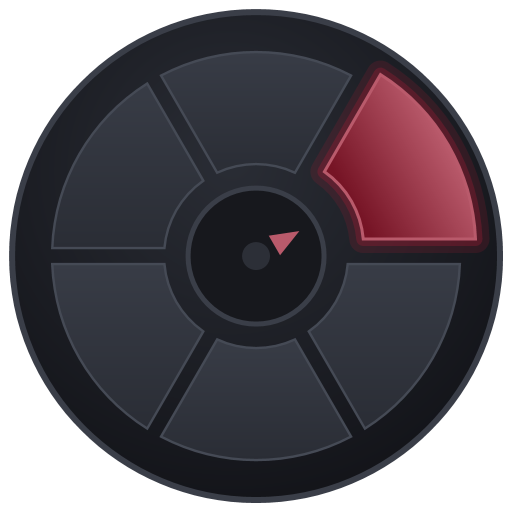
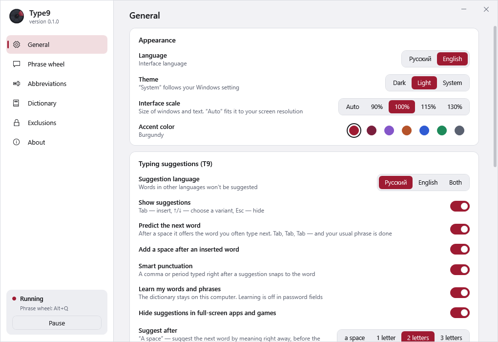

<p align="center"></p>

<h1 align="center">Type9</h1>

<p align="center">
Подсказки при наборе в любом поле Windows — как T9 на телефоне — и круговое меню готовых фраз по горячей клавише.<br>
<i>Typing suggestions in any Windows text field — like T9 on a phone — plus a hotkey wheel of ready-made phrases.</i>
</p>

<p align="center">


</p>

<p align="center"><b>Текущая версия: 0.3.3</b> · <a href="https://github.com/DenHaIz/Type9/releases/latest">Скачать Type9.exe</a></p>

## Возможности

- **Автодополнение везде** — Блокнот, браузеры, мессенджеры, Office. Подсказка появляется у курсора ввода: `Tab` — вставить, `Tab`+`2`/`3` — вставить второй/третий вариант, `↑/↓` или колесо мыши над подсказкой — выбрать вариант, `Esc` — скрыть.
- **Понимает контекст.** Встроенный словарь на 150 000 русских и 100 000 английских слов с моделью пар и троек слов и согласованием окончаний: «в этом мес…» → **месте**, «с колл…» → **коллегами**, «по этому воп…» → **вопросу**.
- **Запятая после приветствия** — «Здр» + `Tab` → «Здравствуйте, », «добрый д» + `Tab` → «добрый день, ». Наберите сразу `!` — получится «Здравствуйте!». Отключается в настройках.
- **Следующее слово по смыслу** — в режиме «Подсказывать после: пробела» предлагает слово ещё до первой буквы («добрый ␣» → «день»). `Tab`, `Tab`, `Tab` — и привычная фраза готова.
- **Учится на вашем тексте** — запоминает ваши слова и обороты, как только вы перешли к следующему слову или сделали паузу. Исправленные опечатки, адреса, почта и пароли не запоминаются. Можно сразу «скормить» программе типовые письма.
- **Круговое меню фраз** (как buy-menu в CS:GO или chat wheel в Dota 2): зажмите `Alt+Q`, наведите мышь на фразу, отпустите — текст вставлен. Цифры `1–8` — мгновенный выбор, колесо мыши или `←/→` — другая группа. Готовые деловые фразы в трёх группах: приветствия, ответы, завершение.
- **Любая клавиша для меню** — сочетание или одна клавиша: F1–F24, CapsLock, правый Ctrl/Alt, кнопка мыши. Если выбранная клавиша мешает стандартным сочетаниям (Ctrl+C, F5, «Назад» на мыши), настройки предупредят.
- **Несколько мониторов** — меню открывается целиком на мониторе под курсором, упирается в его границы и не перекрывает строку, в которой вы печатаете.
- **Сокращения** — `здр` → «Здравствуйте, », `бсп` → «Большое спасибо! », `суваж` → «С уважением,⏎». Подстановки `{date}`, `{time}`, `{clipboard}`.
- **Язык подсказок** — русский (по умолчанию), английский или оба; при русском английские слова не предлагаются.
- **Оформление** — тёмная, светлая или системная тема, бордовый акцент и ещё 6 цветов, плавные анимации; русский и английский интерфейс; масштаб окон и текста под разрешение экрана.
- **Автообновление** из GitHub с проверкой контрольной суммы. Ваш словарь, фразы и настройки при обновлении сохраняются.
- **Два режима** — обычный и «Администратор» (для окон, запущенных с повышенными правами; автозапуск через Планировщик заданий без запроса UAC).

## Установка

Скачайте **`Type9.exe`** со страницы [Releases](https://github.com/DenHaIz/Type9/releases) и запустите — программа появится в трее. Ничего устанавливать не нужно (Windows 10/11 x64). Автозапуск включается в настройках («Общие → Запуск»).

Для режима «Администратор» лучше положить `Type9.exe` в `C:\Program Files\Type9`.

## Обновления

Начиная с версии 0.2 программа обновляется сама: проверяет GitHub при запуске и раз в 6 часов, скачивает новую версию, сверяет контрольную сумму и перезапускается. Проверить вручную — «Общие → Обновления → Проверить сейчас». Версию 0.1 нужно один раз заменить вручную.

## Горячие клавиши

| Клавиша | Действие |
|---|---|
| `Tab` | вставить подсказку |
| `Tab` + `1`–`9` | вставить вариант с этим номером (держите Tab и нажмите цифру) |
| `↑` / `↓`, колесо мыши над подсказкой | выбрать другой вариант |
| `Esc` | скрыть подсказку |
| `Alt+Q` (удерживать) | круговое меню: навести и отпустить |
| `1`–`8` | мгновенный выбор фразы в меню |
| колесо / `←` `→` | другая группа фраз |
| `Ctrl+Alt+P` | пауза / продолжить |

Все сочетания меняются в настройках. Для меню можно выбрать и одну клавишу: нажмите поле и затем клавишу (для правого Ctrl/Alt — зажмите и отпустите).

## Если что-то не так

- **Подсказка «прыгает» в каком-то приложении** — «Общие → Где показывать → В углу экрана».
- **Не работает в окне, запущенном от администратора** — включите режим «Администратор».
- **Мешает в конкретной программе** — добавьте её в «Исключения».
- **Логи и данные** — `%AppData%\Type9` (`log.txt`, `settings.json`, `phrases.json`, `userdict.tsv`).

## Скриншоты

<p>


</p>
<p>


</p>

## Сборка из исходников

Нужен .NET SDK 10.

```powershell
dotnet test Type9.sln          # тесты
.\build\build.ps1              # dist\Type9.exe
```

Дополнительные списки слов можно положить в `%AppData%\Type9\dict\*.txt`. Языковые модели собираются утилитой `tools/DictBuilder`; устройство программы, выпуск версий и известные риски описаны в [HANDOFF.md](HANDOFF.md).

## Данные и лицензии словарей

- Частоты слов — [hermitdave/FrequencyWords](https://github.com/hermitdave/FrequencyWords) (OpenSubtitles 2018), CC BY-SA 4.0.
- Предложения для модели контекста — [Tatoeba](https://tatoeba.org), CC BY 2.0 FR.

---

## English

**Type9** is a Windows tray app:

- **Word completion in any text field** with a popup at the text cursor (`Tab` inserts, `Tab`+digit inserts option N, `↑/↓` or the mouse wheel chooses, `Esc` hides); a comma is added after greetings ("Hello,").
- **Context-aware**: built-in 150k Russian / 100k English language models (word pairs/triples + Russian case agreement), **next-word prediction right after a space**, and learning from your own writing (fixed typos, URLs, e-mails and passwords are never learned).
- **Phrase wheel** (CS:GO buy menu / Dota 2 chat wheel style): hold `Alt+Q`, point, release. Can be bound to a single key or mouse button, with warnings about conflicting shortcuts. Multi-monitor aware: stays on the cursor's monitor and never covers the line you type in.
- Abbreviations, suggestion language (Russian by default), dark & light themes, RU/EN UI, crisp auto UI scale on any DPI, **auto-update from GitHub** with SHA-256 verification (your dictionary is kept).

Download **`Type9.exe`** from [Releases](https://github.com/DenHaIz/Type9/releases) — a single self-contained file.

© denhaiz
