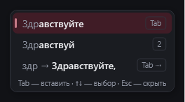
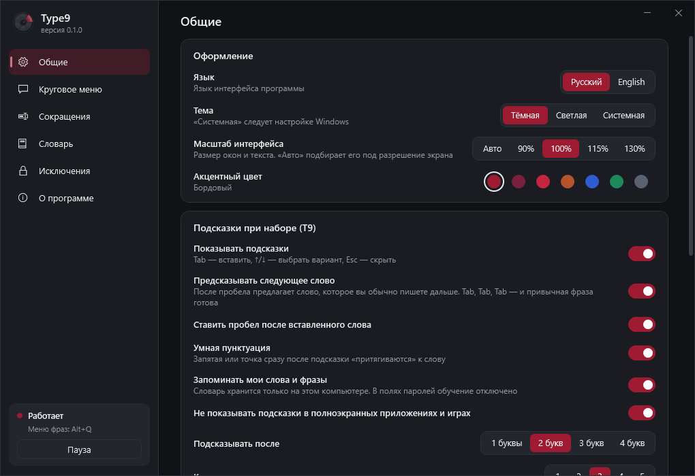

<p align="center"></p>

<h1 align="center">Type9</h1>

<p align="center">
Подсказки при наборе в любом поле Windows — как T9 на телефоне — и круговое меню готовых фраз по горячей клавише.<br>
<i>Typing suggestions in any Windows text field — like T9 on a phone — plus a hotkey wheel of ready-made phrases.</i>
</p>

<p align="center">


</p>

## Возможности

- **Автодополнение везде** — Блокнот, браузеры, мессенджеры, Office. Подсказка появляется у курсора ввода: `Tab` — вставить, `↑/↓` — выбрать вариант, `Esc` — скрыть.
- **Учится на вашем тексте** — запоминает слова и порядок, в котором вы их пишете. После пробела предлагает следующее слово: `Tab`, `Tab`, `Tab` — и привычная фраза готова. Можно сразу «скормить» программе типовые письма.
- **Круговое меню фраз** (как buy-menu в CS:GO или chat wheel в Dota 2): зажмите `Alt+Q`, наведите мышь на фразу, отпустите — текст вставлен. Цифры `1–8` — мгновенный выбор, колесо мыши или `←/→` — другая группа фраз. Можно назначить боковую кнопку мыши.
- **Сокращения** — `здр` → «Здравствуйте, », `суваж` → «С уважением,⏎». Подстановки `{date}`, `{time}`, `{clipboard}`.
- **Тёмная и светлая темы** (или как в системе), бордовый акцент и ещё 6 цветов, плавные анимации.
- **Русский и английский** интерфейс, **масштаб** окон и текста — автоматически под разрешение экрана или вручную.
- **Безопасность**: в полях паролей и программах-исключениях (менеджеры паролей) ничего не запоминается. Все данные — только на этом компьютере.
- **Два режима**: обычный и «Администратор» — для работы в окнах, запущенных с повышенными правами (автозапуск через Планировщик заданий без запроса UAC).

## Установка

Скачайте один файл со страницы [Releases](https://github.com/DenHaIz/Type9/releases):

| Файл | Размер | Что нужно |
|---|---|---|
| `Type9-lite.exe` | ~0,6 МБ | установленный [.NET Desktop Runtime 10](https://dotnet.microsoft.com/download/dotnet/10.0) |
| `Type9.exe` | ~150 МБ | ничего — работает на любой Windows 10/11 x64 |

Запустите — программа появится в трее. Автозапуск включается в настройках («Общие → Запуск»).

## Горячие клавиши

| Клавиша | Действие |
|---|---|
| `Tab` | вставить подсказку |
| `↑` / `↓` | выбрать другой вариант |
| `Esc` | скрыть подсказку |
| `Alt+Q` (удерживать) | круговое меню: навести и отпустить |
| `1`–`8` | мгновенный выбор фразы в меню |
| колесо / `←` `→` | другая группа фраз |
| `Ctrl+Alt+P` | пауза / продолжить |

Все сочетания меняются в настройках.

## Скриншоты

<p>


</p>
<p>


</p>

## Сборка из исходников

Нужен .NET SDK 10.

```powershell
dotnet test Type9.sln          # тесты
.\build\build.ps1              # dist\Type9.exe и dist\Type9-lite.exe
```

Данные пользователя: `%AppData%\Type9` (`settings.json`, `phrases.json`, `userdict.tsv`, `log.txt`). Дополнительные частотные словари можно положить в `%AppData%\Type9\dict\*.txt` (по слову в строке, от частых к редким).

Подробности для разработчиков — в [HANDOFF.md](HANDOFF.md).

---

## English

**Type9** is a lightweight Windows tray app:

- **Word completion in any text field** with a popup at the text cursor (`Tab` inserts, `↑/↓` chooses, `Esc` hides) and **next-word prediction** learned from your own writing.
- **Phrase wheel** (CS:GO buy menu / Dota 2 chat wheel style): hold `Alt+Q`, point, release. Digits `1–8`, mouse wheel / `←→` for groups, side mouse buttons supported.
- **Abbreviations** with `{date}`, `{time}`, `{clipboard}` placeholders.
- Dark & light themes, Russian & English UI, auto UI scale for your screen, smooth animations.
- Password fields and excluded apps are never learned from; everything stays on your PC.
- Normal and Administrator modes (the latter works in elevated windows; autostart via Task Scheduler).

Download a single `.exe` from [Releases](https://github.com/DenHaIz/Type9/releases): `Type9-lite.exe` (needs .NET Desktop Runtime 10) or `Type9.exe` (self-contained).

© denhaiz
