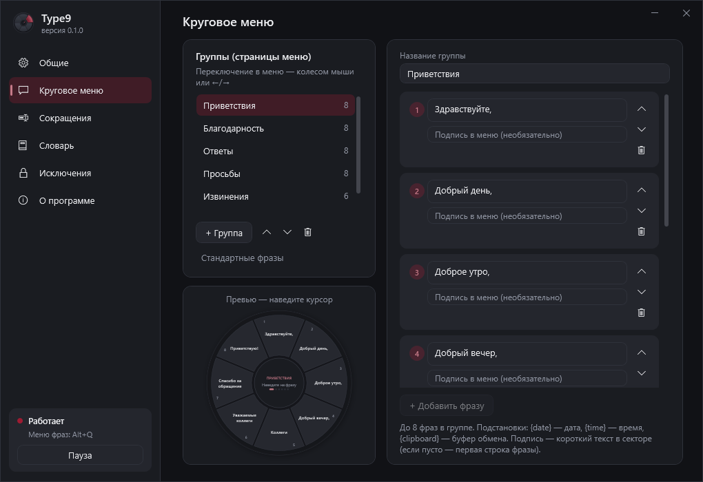
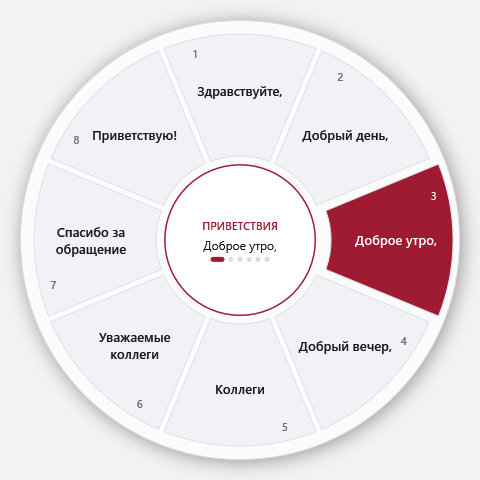

<p align="center"></p>

<h1 align="center">Type9</h1>

<p align="center">
Подсказки при наборе в любом поле Windows — как T9 на телефоне — и круговое меню готовых фраз по горячей клавише.<br>
<i>Typing suggestions in any Windows text field — like T9 on a phone — plus a hotkey wheel of ready-made phrases.</i>
</p>

<p align="center">


</p>

## Возможности

- **Автодополнение везде** — Блокнот, браузеры, мессенджеры, Office. Подсказка появляется у курсора ввода: `Tab` — вставить, `↑/↓` — выбрать вариант, `Esc` — скрыть.
- **Понимает контекст.** Встроенный словарь на 150 000 русских и 100 000 английских слов с моделью пар и троек слов и согласованием окончаний: «в этом мес…» → **месте**, «с колл…» → **коллегами**, «по этому воп…» → **вопросу**.
- **Следующее слово по смыслу** — в режиме «Подсказывать после: пробела» предлагает слово ещё до первой буквы («добрый ␣» → «день»). `Tab`, `Tab`, `Tab` — и привычная фраза готова.
- **Учится на вашем тексте** — запоминает ваши слова и обороты; можно сразу «скормить» программе типовые письма.
- **Круговое меню фраз** (как buy-menu в CS:GO или chat wheel в Dota 2): зажмите `Alt+Q`, наведите мышь на фразу, отпустите — текст вставлен. Цифры `1–8` — мгновенный выбор, колесо мыши или `←/→` — другая группа. Готовые деловые фразы: приветствия, благодарность, ответы, просьбы, извинения, завершение.
- **Сокращения** — `здр` → «Здравствуйте, », `спсо` → «Спасибо за обращение! », `суваж` → «С уважением,⏎». Подстановки `{date}`, `{time}`, `{clipboard}`.
- **Язык подсказок** — русский (по умолчанию), английский или оба; при русском английские слова не предлагаются.
- **Оформление** — тёмная, светлая или системная тема, бордовый акцент и ещё 6 цветов, плавные анимации; русский и английский интерфейс; масштаб окон и текста под разрешение экрана.
- **Автообновление** из GitHub с проверкой контрольной суммы. Ваш словарь, фразы и настройки при обновлении сохраняются.
- **Безопасность** — в полях паролей и программах-исключениях ничего не запоминается. Все данные — только на этом компьютере.
- **Два режима** — обычный и «Администратор» (для окон, запущенных с повышенными правами; автозапуск через Планировщик заданий без запроса UAC).

## Установка

Скачайте **`Type9.exe`** со страницы [Releases](https://github.com/DenHaIz/Type9/releases) и запустите — программа появится в трее. Ничего устанавливать не нужно (Windows 10/11 x64). Автозапуск включается в настройках («Общие → Запуск»).

## Горячие клавиши

| Клавиша | Действие |
|---|---|
| `Tab` | вставить подсказку |
| `↑` / `↓` | выбрать другой вариант |
| `Esc` | скрыть подсказку |
| `Alt+Q` (удерживать) | круговое меню: навести и отпустить |
| `1`–`8` | мгновенный выбор фразы в меню |
| колесо / `←` `→` | другая группа фраз |
| `Ctrl+Alt+P` | пауза / продолжить |

Все сочетания меняются в настройках.

## Скриншоты

<p>


</p>
<p>


</p>

## Сборка из исходников

Нужен .NET SDK 10.

```powershell
dotnet test Type9.sln          # тесты
.\build\build.ps1              # dist\Type9.exe
```

Данные пользователя: `%AppData%\Type9` (`settings.json`, `phrases.json`, `userdict.tsv`, `log.txt`). Дополнительные списки слов можно положить в `%AppData%\Type9\dict\*.txt`.

Языковые модели собираются утилитой `tools/DictBuilder` — подробности в [HANDOFF.md](HANDOFF.md).

## Данные и лицензии словарей

- Частоты слов — [hermitdave/FrequencyWords](https://github.com/hermitdave/FrequencyWords) (OpenSubtitles 2018), CC BY-SA 4.0.
- Предложения для модели контекста — [Tatoeba](https://tatoeba.org), CC BY 2.0 FR.

---

## English

**Type9** is a Windows tray app:

- **Word completion in any text field** with a popup at the text cursor (`Tab` inserts, `↑/↓` chooses, `Esc` hides).
- **Context-aware**: built-in 150k Russian / 100k English language models (word pairs/triples + Russian case agreement), plus **next-word prediction right after a space** and learning from your own writing.
- **Phrase wheel** (CS:GO buy menu / Dota 2 chat wheel style): hold `Alt+Q`, point, release. Business phrase sets out of the box.
- Abbreviations, suggestion language (Russian by default), dark & light themes, RU/EN UI, auto UI scale, **auto-update from GitHub** (your dictionary is kept).

Download **`Type9.exe`** from [Releases](https://github.com/DenHaIz/Type9/releases) — a single self-contained file.

© denhaiz
