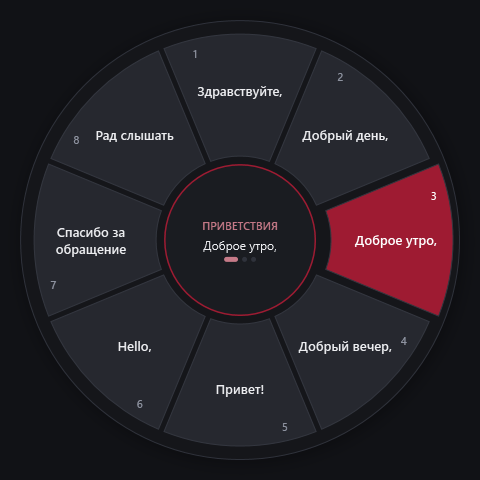

<h1 align="center">Type9</h1>

<a href="https://github.com/DenHaIz/Type9/releases/latest"><b>Скачать / Download Type9.exe</b></a> · v0.3.3 · Windows 10/11 x64

## Русский

Подсказки при наборе в любом поле Windows (как T9) и круговое меню готовых фраз по горячей клавише.

- **Подсказки:** `Tab` — вставить, `Tab`+`2`/`3` — другой вариант, `↑/↓` или колесо мыши — выбор, `Esc` — скрыть.
- **Понимает контекст и падежи**, предлагает следующее слово, учится на вашем тексте (пароли и адреса не запоминаются).
- **Круговое меню:** зажмите `Alt+Q` (или любую клавишу/кнопку мыши), наведите на фразу, отпустите.
- Сокращения (`здр` → «Здравствуйте, »), тёмная и светлая тема, интерфейс RU/EN, автообновление.

Один файл без установки: скачайте и запустите, программа появится в трее. Настройки, словарь и фразы — в `%AppData%\Type9`.

## English

Typing suggestions in any Windows text field (like T9) and a hotkey wheel of ready-made phrases.

- **Suggestions:** `Tab` inserts, `Tab`+`2`/`3` picks another option, `↑/↓` or the mouse wheel chooses, `Esc` hides.
- **Context-aware** (incl. Russian word endings), predicts the next word, learns from your writing (passwords and addresses are never stored).
- **Phrase wheel:** hold `Alt+Q` (or any key/mouse button), point at a phrase, release.
- Abbreviations (`ty` → "Thank you! "), dark and light themes, RU/EN interface, auto-update.

A single file, no installation: download, run, and it appears in the tray. Settings, dictionary and phrases live in `%AppData%\Type9`.

---

Сборка / Build: `dotnet test Type9.sln`, `.\build\build.ps1` (.NET SDK 10). Подробности для разработчика / developer notes: [HANDOFF.md](HANDOFF.md).
Словари / Dictionaries: [FrequencyWords](https://github.com/hermitdave/FrequencyWords) (CC BY-SA 4.0), [Tatoeba](https://tatoeba.org) (CC BY 2.0 FR). © denhaiz
